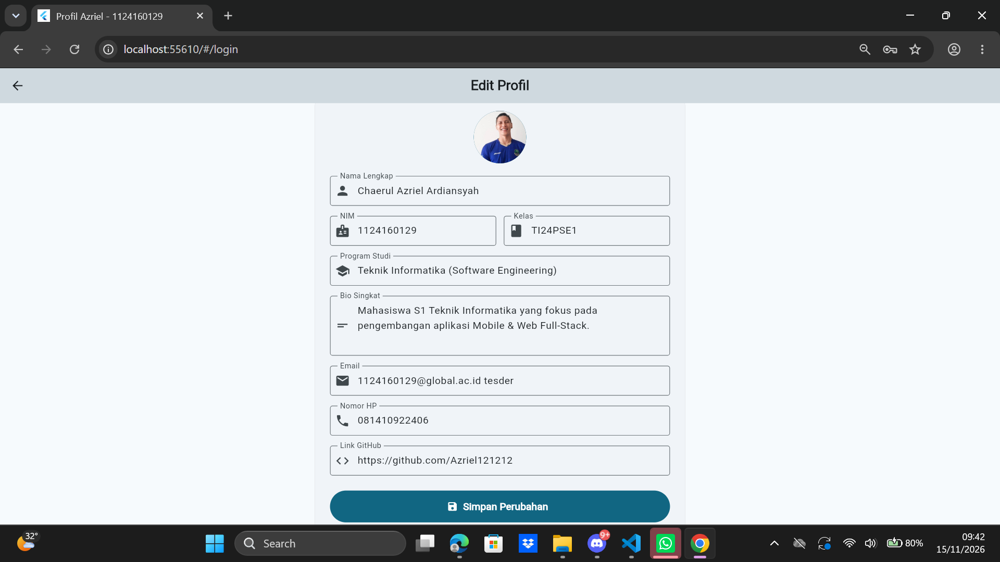
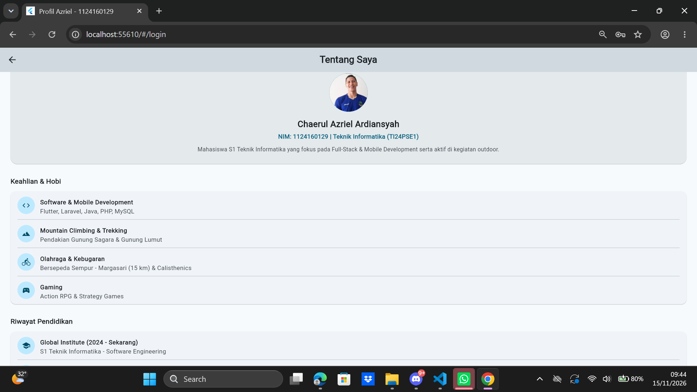

# UTS Pemrograman Mobile Lanjut (Flutter)

## Identitas Mahasiswa
- **Nama Lengkap:** Chaerul Azriel Ardiansyah
- **NIM:** 1124160129
- **Kelas:** TI24PSE1
- **Program Studi:** S1 Teknik Informatika (Software Engineering)
- **Perguruan Tinggi:** Institut Teknologi dan Bisnis Bina Sarana Global (Global Institute)

---

## Link Penting (Video YouTube & Release APK)
- **Video Presentasi YouTube:** [Tonton Video Presentasi UTS - Chaerul Azriel Ardiansyah](https://youtube.com/) *(Link diperbarui setelah upload)*
- **Download APK (v1.0.0):** [Unduh app-release.apk di GitHub Releases](https://github.com/Azriel121212/uts-pml-1124160129/releases/tag/v1.0.0)

---

## Struktur Repositori
1. **soal1_live_coding/**: Proyek Live Coding pembuatan kartu profil mahasiswa 1 halaman (Stateless Widget).
2. **soal2_profil_app/**: Proyek aplikasi profil mahasiswa multi-halaman (StatefulWidget, Form Validation, Navigation & Routes, Dynamic Theme).

---

## Daftar Fitur Utama (soal2_profil_app)
1. **Halaman Login (LoginPage)**:
   - Validasi input NIM/Email dan Password (minimal 6 karakter) menggunakan Form dan GlobalKey.
   - Fitur lihat/sembunyikan password dan indikator loading (CircularProgressIndicator).
   - Navigasi ke halaman utama menggunakan Navigator.pushReplacement.
2. **Halaman Profil Utama (ProfilePage)**:
   - Menampilkan foto profil lokal dari assets/images/profile.jpg dengan CircleAvatar.
   - Menampilkan identitas mahasiswa, bio singkat, dan kartu informasi kontak menggunakan reusable widget InfoTile.
   - Dilengkapi komponen Scaffold tambahan: Drawer (menu samping), AlertDialog konfirmasi logout, dan FloatingActionButton.
3. **Halaman Edit Profil (EditProfilePage)**:
   - Mengelola nilai awal form menggunakan TextEditingController pada initState() dan membersihkannya pada dispose().
   - Validasi form lengkap (wajib diisi, format email valid '@', nomor HP hanya angka 10-13 digit).
   - Mengirimkan objek Profile terbaru kembali ke halaman utama menggunakan Navigator.pop(context, updatedProfile) dan memperbarui tampilan secara langsung dengan setState().
4. **Halaman Tentang Saya (AboutPage)**:
   - Menampilkan daftar keahlian, hobi, dan riwayat pendidikan menggunakan ListView.
5. **Tema Terang & Gelap (Light / Dark Mode)**:
   - Menggunakan Material 3 dengan skema warna BlueGrey yang dapat diganti secara langsung melalui tombol pada AppBar.
6. **Identitas Aplikasi Android**:
   - Label aplikasi Android telah dikonfigurasi menjadi **"Profil Azriel"** pada AndroidManifest.xml.

---

## Screenshot Aplikasi (soal2_profil_app)

| Halaman Login | Halaman Profil Utama |
| :---: | :---: |
|  |  |

| Halaman Edit Profil | Halaman Tentang Saya |
| :---: | :---: |
|  |  |

---

## Cara Menjalankan Proyek
1. Clone repositori ini:
   `git clone [https://github.com/Azriel121212/uts-pml-1124160129.git](https://github.com/Azriel121212/uts-pml-1124160129.git)`
2. Masuk ke direktori proyek:
   `cd soal2_profil_app`
3. Unduh seluruh paket dependencies:
   `flutter pub get`
4. Jalankan aplikasi di perangkat/emulator:
   `flutter run`
5. Untuk mem-build file APK Release:
   `flutter build apk --release`