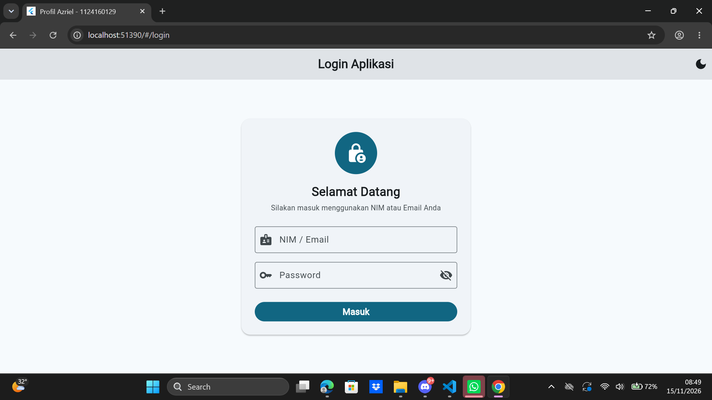
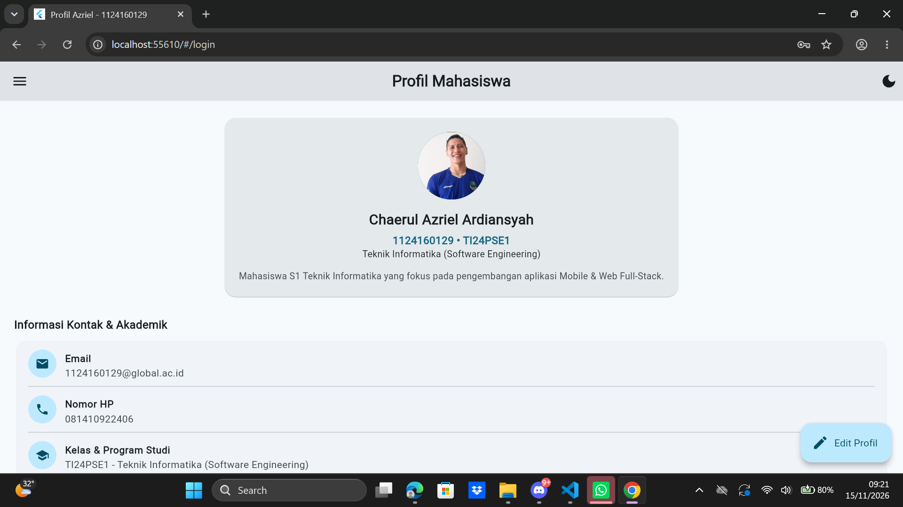

# UTS Pemrograman Mobile Lanjut (Flutter)

## Identitas Mahasiswa
- **Nama Lengkap:** Chaerul Azriel Ardiansyah
- **NIM:** 1124160129
- **Kelas:** TI24PSE1
- **Program Studi:** S1 Teknik Informatika (Software Engineering)
- **Perguruan Tinggi:** Institut Teknologi dan Bisnis Bina Sarana Global (Global Institute)

---

## Link Video Presentasi YouTube
- **YouTube:** [Link Video Presentasi UTS - Chaerul Azriel Ardiansyah](https://youtube.com/) *(Akan diperbarui setelah upload video)*

---

## Struktur Repositori
1. **`soal1_live_coding/`**: Proyek Live Coding pembuatan kartu profil mahasiswa (Stateless Widget).
2. **`soal2_profil_app/`**: Proyek aplikasi profil mahasiswa multi-halaman (StatefulWidget, Form Validation, Navigation & Routes, Dynamic Theme).

---

## Daftar Fitur (`soal2_profil_app`)
- **Halaman Login**: Validasi input NIM/Email dan Password (minimal 6 karakter), indikator *loading*, dan navigasi `pushReplacement`.
- **Halaman Profil Utama**: Menampilkan foto profil lokal (`assets/images/profile.jpg`) dengan `CircleAvatar`, biodata lengkap, kartu kontak (`InfoTile`), `Drawer` navigasi, konfirmasi `AlertDialog` saat logout, serta `FloatingActionButton`.
- **Halaman Edit Profil**: Mengubah data profil secara *real-time* menggunakan `TextEditingController`, validasi form, `Navigator.pop` dengan pengiriman data kembali, serta pembaruan *state* (`setState`).
- **Halaman Tentang Saya**: Menampilkan daftar keahlian, hobi, dan riwayat pendidikan menggunakan `ListView`.
- **Tema Gelap & Terang**: Mendukung pergantian `Light Mode` dan `Dark Mode` secara langsung melalui tombol pada `AppBar`.

---

## Screenshot Aplikasi (`soal2_profil_app`)

| Halaman Login | Halaman Profil Utama |
| :---: | :---: |
|  |  |

| Halaman Edit Profil | Halaman Tentang Saya |
| :---: | :---: |
|  |  |

---

## Cara Menjalankan Aplikasi
1. Masuk ke direktori proyek:
   ```bash
   cd soal2_profil_app